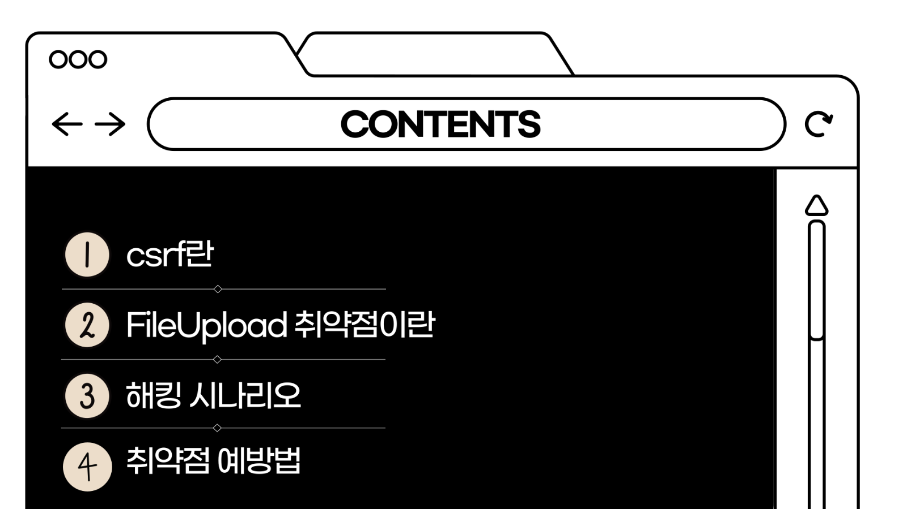
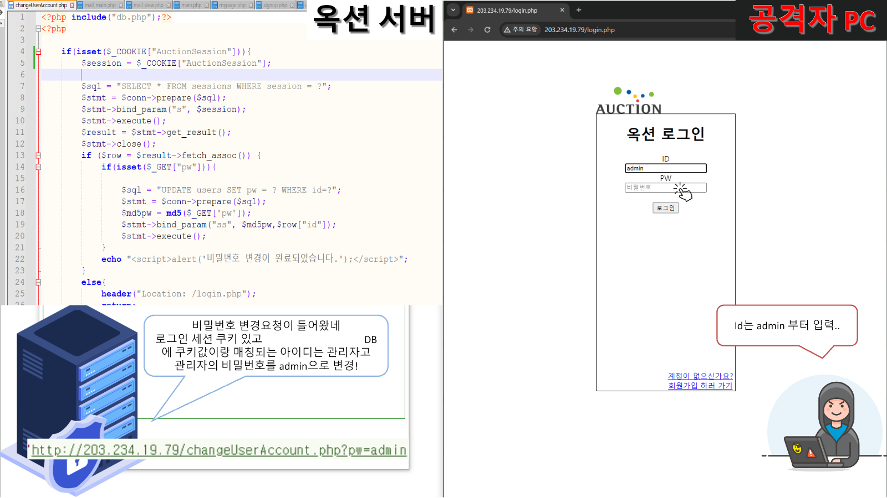
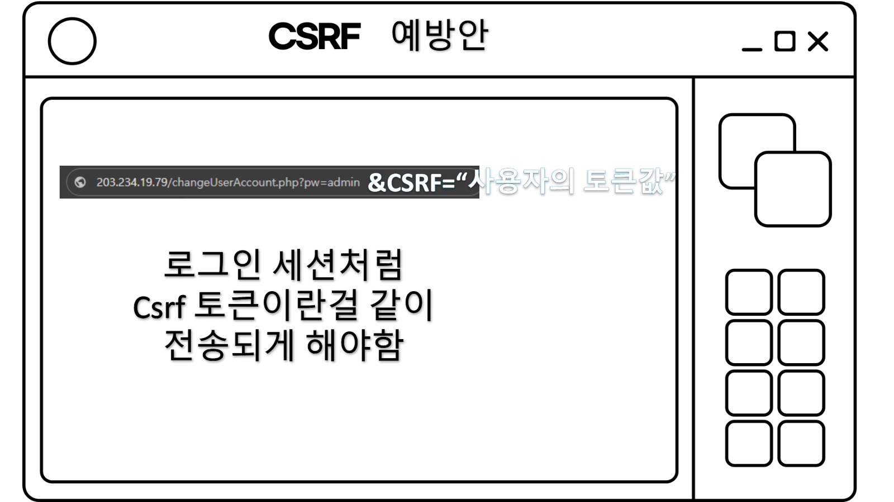
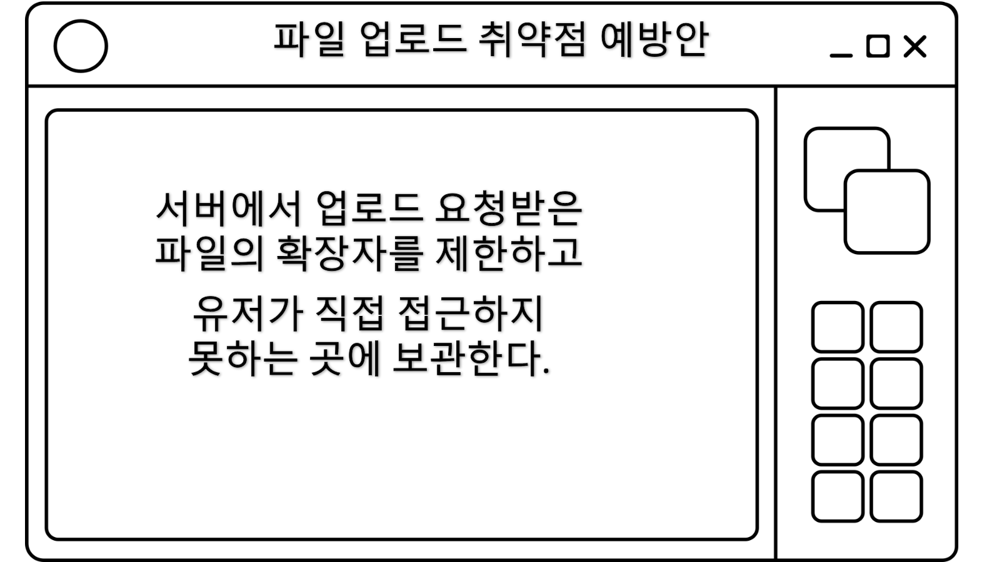

# Auction Web Security Lab

2008년 옥션 해킹 사례에서 알려진 공격 흐름을 로컬 웹 애플리케이션으로 재구성한 웹 보안 실습 프로젝트입니다. 단순히 취약점 하나를 실행하는 데서 끝내지 않고, **CSRF를 이용한 관리자 계정 탈취 → 관리자 권한의 무제한 파일 업로드 → 서버 명령 실행 가능성**으로 이어지는 연쇄 위험을 직접 구현하고 분석했습니다.

> 이 저장소는 교육·포트폴리오 목적의 의도적으로 취약한 코드입니다. 인터넷에 노출하거나 실제 서비스에 배포하지 마세요.

## 프로젝트 개요

- 기간: 2024.03 ~ 2024.07
- 형태: 개인 프로젝트
- 담당: 환경 구축, PHP·MariaDB 구현, 공격 시나리오 설계 및 재현, 대응 방안 분석
- 환경: Apache 2.4.58, MariaDB 10.4.32, PHP 8.2.12, Windows 10
- 구현 기능: 회원가입, 로그인, 쿠키·DB 기반 세션, 사용자 문의 메일, 관리자 메일 열람, 비밀번호 변경, 관리자 파일 업로드



## 핵심 시나리오

1. 비밀번호 변경 기능이 로그인 쿠키만 확인하고 `GET` 요청을 받아 처리합니다.
2. 공격자는 관리자에게 보낼 문의 메일의 ``에 비밀번호 변경 URL을 넣습니다.
3. 관리자가 메일을 열면 브라우저가 이미지 주소를 자동 요청하고, 관리자 쿠키와 함께 비밀번호 변경 요청이 전송됩니다.
4. 탈취한 관리자 계정으로 로그인한 공격자는 확장자와 저장 위치 제한이 없는 업로드 기능에 접근합니다.
5. 서버에서 실행 가능한 파일이 웹 경로에 저장되면 원격 명령 실행으로 이어질 수 있음을 확인했습니다.



## 코드에서 확인할 수 있는 지점

| 파일 | 역할 | 보안 관찰 지점 |
|---|---|---|
| `src/changeUserAccount.php` | 계정 비밀번호 변경 | 상태 변경을 `GET`으로 처리하고 CSRF 토큰을 검증하지 않음 |
| `src/mail_main.php` | 사용자 문의 메일 작성 | 로그인 세션으로 발신자를 결정하고 prepared statement로 저장 |
| `src/mail_view.php` | 관리자 메일 열람 | `` 허용 방식의 필터가 외부·내부 URL 요청을 막지 못함 |
| `src/upload.php` | 관리자 파일 업로드 | 확장자·MIME·저장 경로 제한이 없어 실행 파일 업로드 가능 |
| `src/login.php` | 로그인과 세션 생성 | 교육 당시 구현으로 MD5와 예측 가능성이 있는 세션 생성 방식을 사용 |
| `src/mypage.php` | 사용자·관리자 메뉴 | 서버 측에서 세션과 관리자 권한을 확인 |

## 적용했던 방어와 한계

실습에서는 공격 흐름 외의 변수를 줄이기 위해 대부분의 인증·회원 관련 DB 쿼리에 prepared statement를 적용하고, 관리자 전용 페이지에서 세션과 `isAdmin` 값을 확인했습니다. 다만 결과물 전체가 운영 수준의 보안 구현은 아닙니다. `mail_view.php`의 메일 번호 조회, MD5 비밀번호 해시, 세션 쿠키 속성 등은 추가 개선 대상입니다.

핵심 취약점의 대응책은 다음과 같이 정리했습니다.

- 모든 상태 변경 요청은 `POST`로 전환하고, 사용자 세션에 결합된 CSRF 토큰을 서버에서 검증합니다.
- HTML 문자열 일부를 허용하는 방식 대신 안전한 이미지 식별자만 받고, 서버가 검증한 저장 경로로 변환합니다.
- 업로드는 허용 목록 기반 확장자·MIME·파일 시그니처를 함께 검사합니다.
- 업로드 파일은 웹 루트 밖에 저장하고, 임의 파일명을 부여해 직접 실행할 수 없게 합니다.
- 비밀번호는 `password_hash()`/`password_verify()`를 사용하고 세션 ID는 암호학적으로 안전한 난수로 생성합니다.





## 로컬 실행

1. Apache, PHP 8.x, MariaDB를 준비합니다.
2. `database/schema.sql`을 로컬 MariaDB에 적용합니다.
3. Apache의 DocumentRoot를 `src`로 설정합니다.
4. 아래 환경변수를 로컬 환경에 설정합니다.

```text
AUCTION_DB_HOST=localhost
AUCTION_DB_USER=auction_lab
AUCTION_DB_PASSWORD=로컬에서_정한_비밀번호
AUCTION_DB_NAME=auction
```

5. 회원가입 후, 로컬 DB에서 실습용 관리자 계정의 `isAdmin`을 `1`로 변경합니다.

```sql
UPDATE users SET isAdmin = 1 WHERE id = '실습용_관리자_ID';
```

## 공개본 범위

- 원본 XAMPP 대시보드와 무관한 기본 파일은 제외했습니다.
- 수업 조 편성 PDF 등 개인정보가 포함될 수 있는 자료는 제외했습니다.
- 발표에서 사용한 웹 셸 파일과 구체적인 공격 페이로드는 공개본에서 제외했습니다.
- DB 계정 정보는 환경변수로 분리했고, 실제 사용자 데이터와 DB 덤프는 포함하지 않았습니다.

## 참고 및 권리 고지

메인 화면의 시각적 재현에는 2008년 Internet Archive에 보존된 옥션 페이지 일부를 참고했습니다. 해당 UI, 상표, 로고의 권리는 원 권리자에게 있으며 이 저장소는 비상업적 교육용 재현물입니다. 별도 라이선스가 명시되지 않은 제3자 자산을 재사용하지 마세요.

